# RomMix-Remix screenshots

Interface examples from the Linux application. Earlier captures retain the
original RomMix name in the footer.

## Home

Last played with description and time played, random choice, anniversaries and artwork shelves.

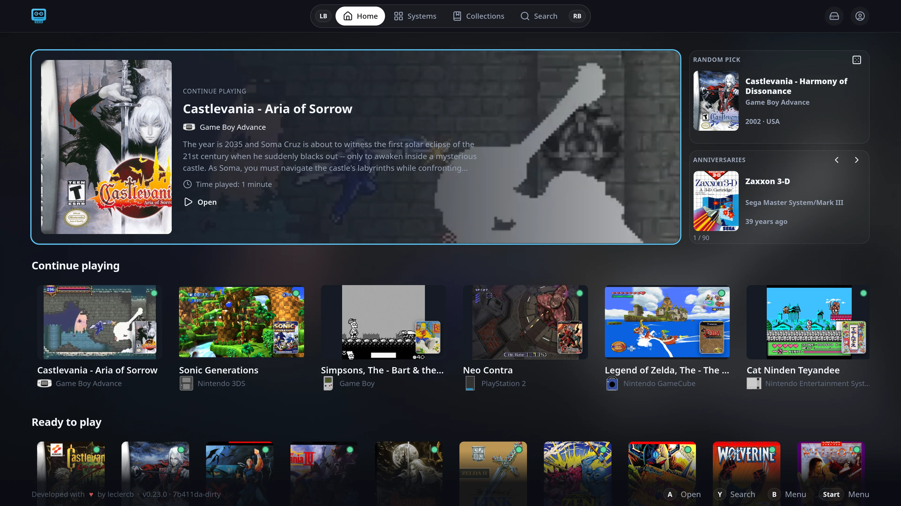

## Systems and library

Grouping by generation, platform carousel, full-width covers and a metadata table.

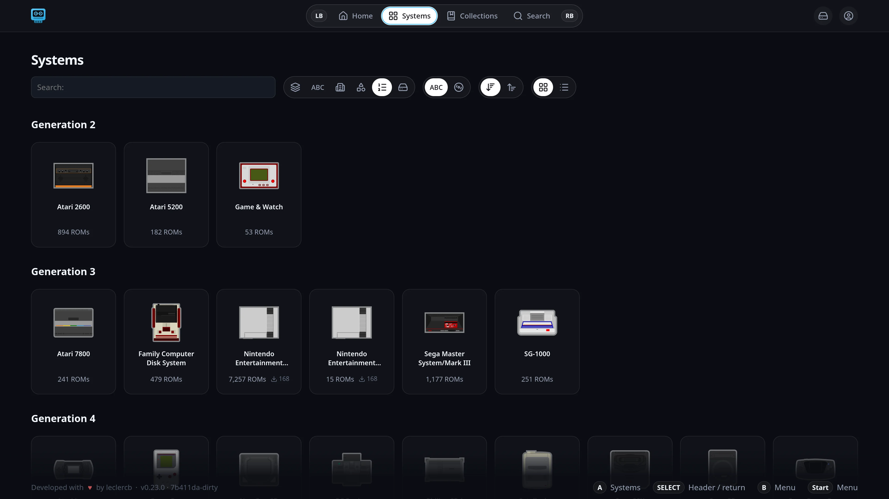
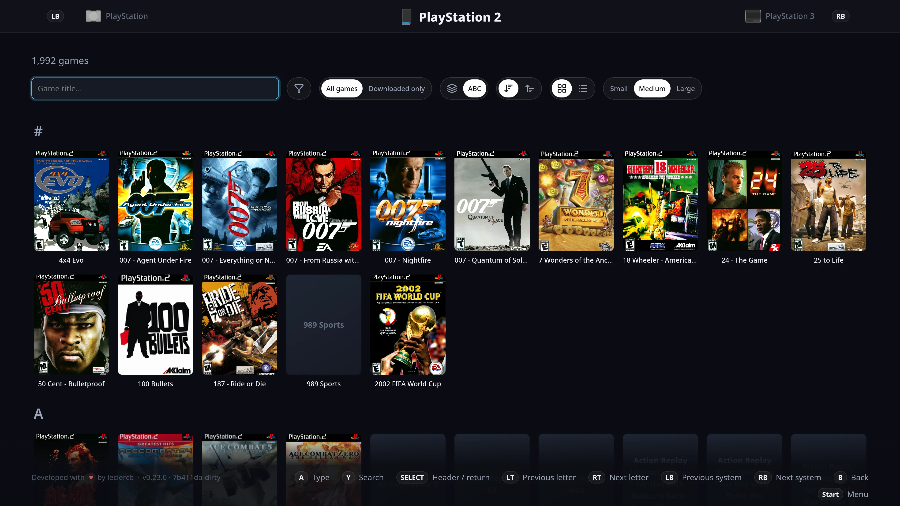
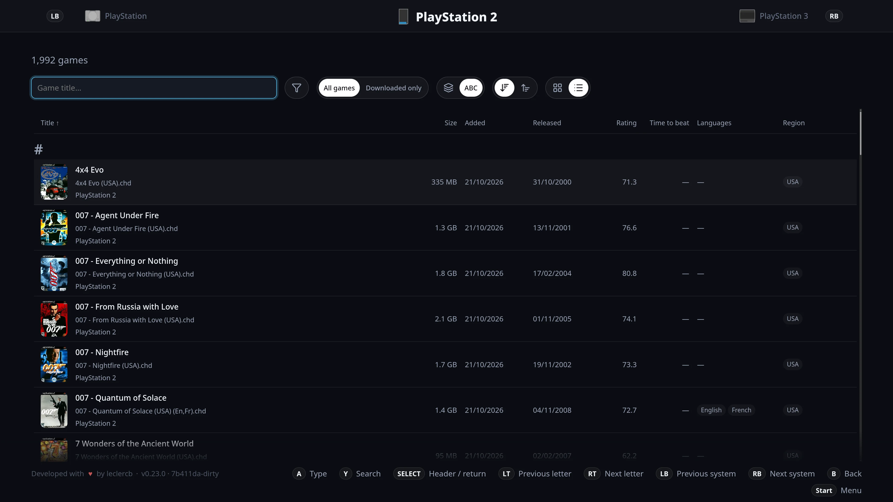

## Game card and versions

Overview video, compact screenshot gallery, server metadata and retained game actions.

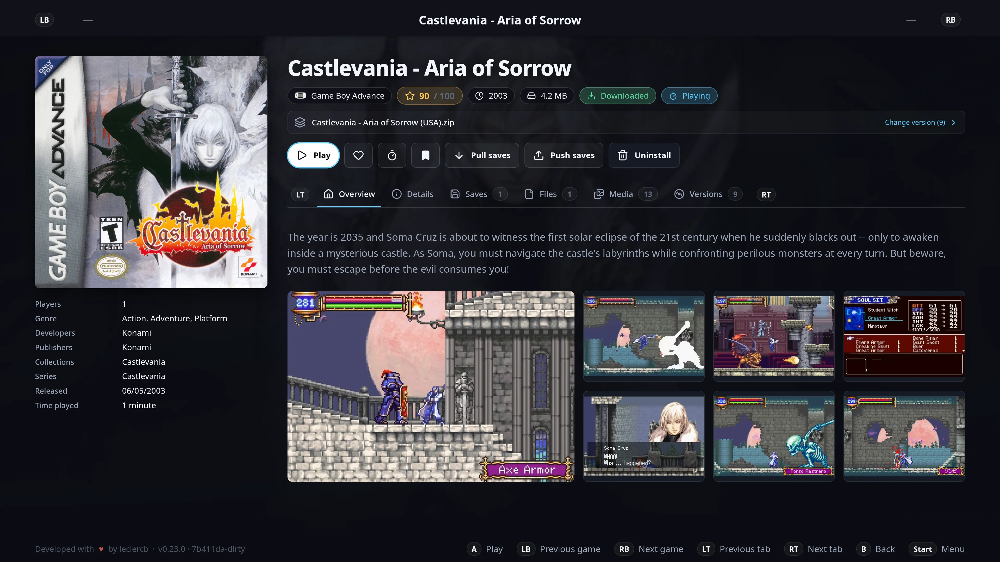
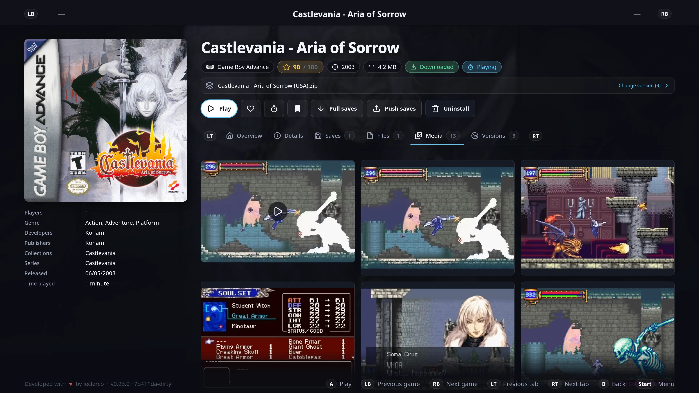
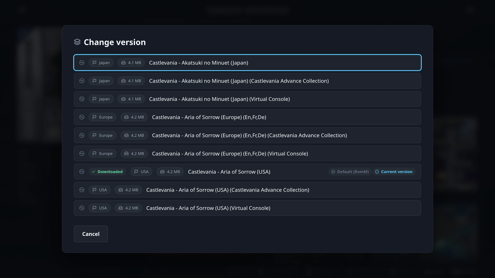

## Gamepad filters

Categories, tri-state properties and optional HowLongToBeat ranges. Available data
depends on the server; these screenshots do not demonstrate a positive duration match.

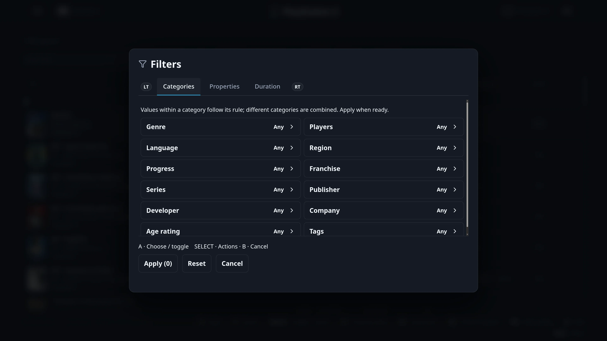
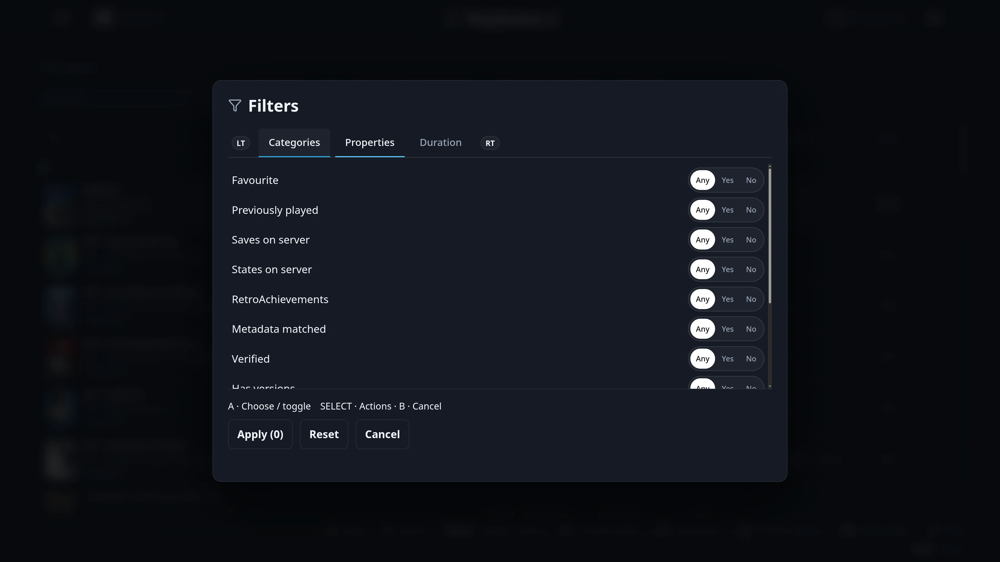
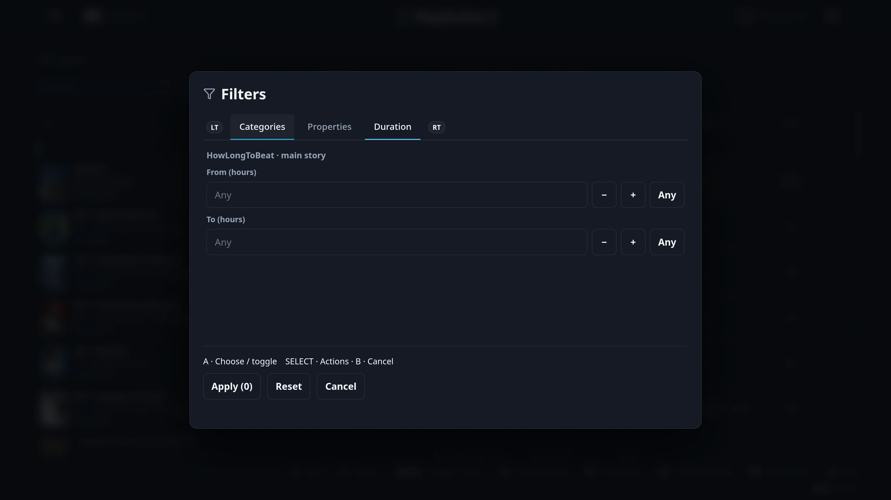

## Collections and utilities

Server-generated virtual collections and the compact menu.

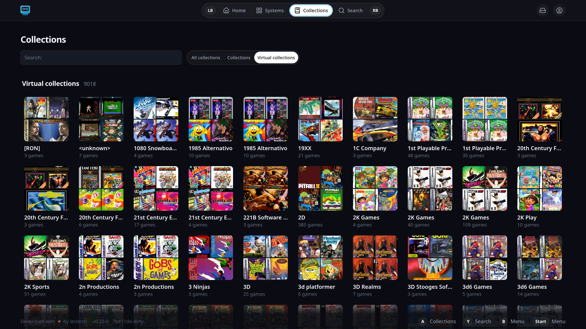
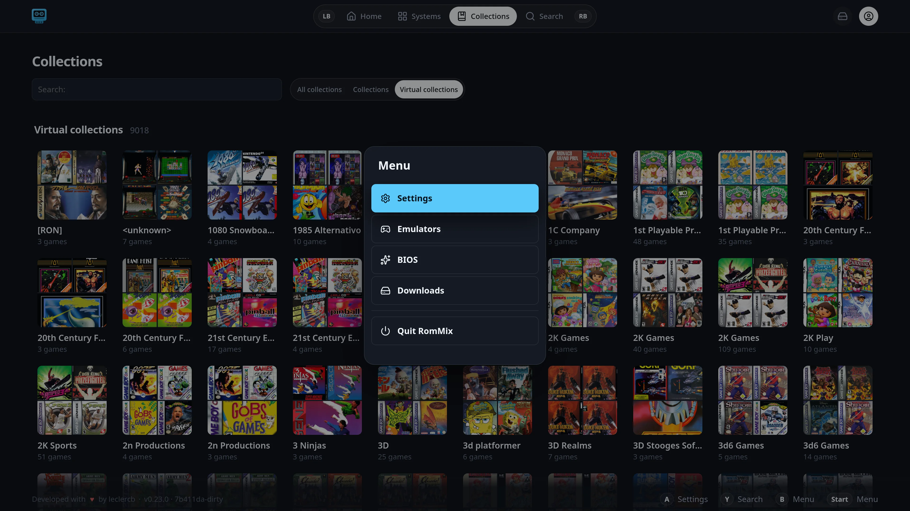

## Experimental EmuDeck/ES-DE enrichment

Optional metadata and media export for completed downloads into verified EmuDeck paths.

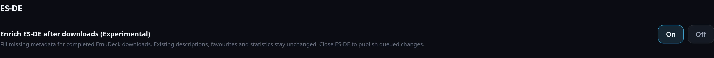

Game art and video frames are the property of their respective owners. The
repository contains no ROMs, BIOS, saves, credentials or library exports.
